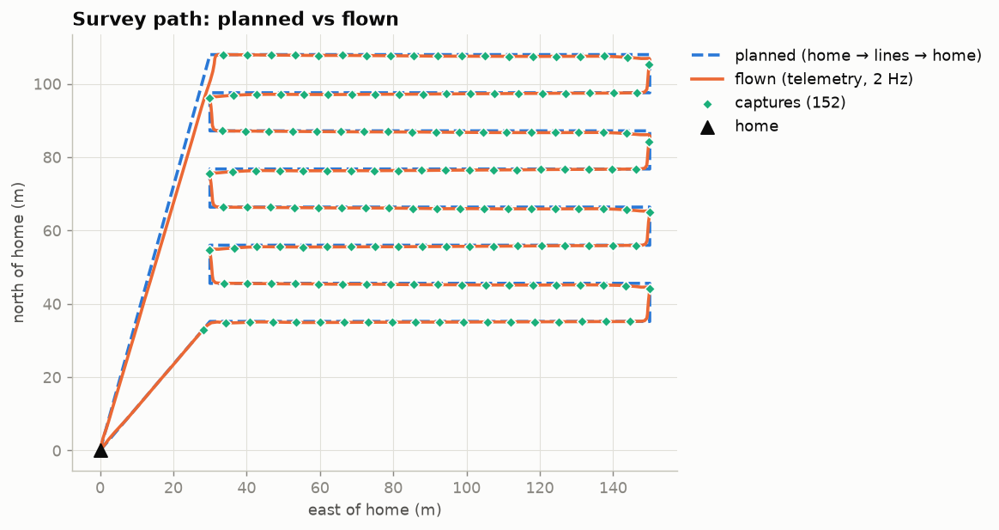

# AgriSurvey-Link

[](https://github.com/amrinder-3184/agrisurvey-link/actions/workflows/ci.yml)

A simulated agricultural survey drone. A C++17 companion-computer service plans a lawnmower
survey from a field polygon and a camera model, flies it on **PX4 SITL** (Gazebo, x500 quad) through
MAVSDK, triggers a payload by distance and geotags every capture. A link monitor built on a
**from-scratch MAVLink v2 parser** reports packet loss and heartbeat health. A Python report
analyses each flight.

> **Status: complete (phases 0–7). Simulation only.** Every number below comes from a committed
> run folder or a command you can re-run. Details: [docs/test-report.md](docs/test-report.md).



## Results

| Metric | Value | Evidence |
|---|---|---|
| Survey flight (one command: `scripts/run_demo.sh`) | success: 16 waypoints, 8 lines, 1173 m flown in 303 s | `runs/demo/report/summary.json` |
| Captures per survey | **152** (19 per line), 0 queue drops | `runs/demo/geotags.csv`; same count in 5 survey flights |
| Trigger spacing error vs planned 6.213 m | **mean 0.259 m**, p95 0.397 m, max 0.508 m (144 pairs) | `python3 analysis/spacing.py runs/demo` |
| Link loss during the demo flight | 0 lost of 117,808 frames, 375.2 frames/s, 0 CRC errors | `runs/demo/link_stats.csv` |
| Loss measured under 5 % injected loss (`tc netem`) | **4.88 %** (baseline and recovery 0.00 %) | `runs/link-netem-5pct-20261031-142544` |
| GPS loss (`failure gps off`) | PX4 blind land after 5.5 s; node detects it, sends no commands, exit 6 | `runs/20261102-045711` |
| GCS data-link loss | Hold after 12.9 s, Return after 17.9 s, lands at home; exit 6 | `runs/20261102-050131` |
| Unit tests | **78** GoogleTest cases (33 for CRC / parser / link stats) + 4 pytest; ASan/UBSan clean, 0 warnings | `ctest`, CI |

## Architecture

```
PX4 SITL + Gazebo (x500)
 ├─ UDP 14540 ─> mission_node (C++17, MAVSDK)
 │                ├─ survey planner: field polygon + camera footprint -> lawnmower waypoints
 │                ├─ upload / arm / takeoff / start mission / RTL, failsafe detection
 │                ├─ position callback -> DistanceTrigger -> CaptureQueue (bounded, never blocks)
 │                ├─ GeotagLogger thread -> geotags.csv
 │                └─ main thread: telemetry.csv, events.csv, run_meta.json
 └─ UDP 14550 ─> link_monitor (C++17, own MAVLink v2 parser, no MAVLink library)
                  └─ link_stats.csv: frames, CRC errors, loss, reordering, heartbeat age
after landing:   analysis/report.py -> path, spacing, SYNTHETIC NDVI, link plots, report.html
```

## Quick start

Setup of PX4, Gazebo and MAVSDK: [docs/SETUP.md](docs/SETUP.md). Then:

```bash
cmake -S . -B build && cmake --build build -j2
ctest --test-dir build --output-on-failure        # 78 tests
python3 -m pytest analysis/tests -q              # 4 tests
scripts/run_demo.sh                              # fly + link monitor + report -> runs/demo/
scripts/failure_test.sh gps                      # or: datalink | none
scripts/netem_loss_test.sh 5                     # needs sudo for tc
```

## Design decisions

- **No I/O in MAVSDK callbacks.** The position callback only decides, builds a `Capture` and pushes
  it. File writes happen in the logger thread (geotags) and the main thread (telemetry, events).
- **Bounded queue that drops the oldest** instead of blocking: the flight-side producer must never
  stall. Drops are counted and reported (0 in every flight).
- **State shared with callbacks is declared before the MAVSDK objects**, so it outlives every callback
  (C++ destroys in reverse order).
- **Own MAVLink parser:** resyncs by skipping one byte after a bad frame, never trusting a corrupted
  length. Tested against real frames encoded by pymavlink.
- **Loss = per-source sequence gaps, with the RTP half-window rule for reordering.** The first netem test
  reported 70 % loss for 5 % injected. Reordered packets were being counted as 254-frame gaps.
- **Failsafe: never fight the autopilot.** If PX4 leaves Mission mode early, the node logs it and stops
  commanding.
- **Explicit exit codes** (0 ok … 6 failsafe, 130 Ctrl-C) and `run_meta.json` per run, so every run is
  traceable.

## Limitations

- Simulation only (PX4 SITL + Gazebo); no real camera, radio or airframe.
- **NDVI values are SYNTHETIC** (a formula in `include/asl/synthetic_field.h`), labelled as such everywhere.
- The flown track is PX4's own position estimate, not ground truth (it drifts after GPS loss).
- Captures are taken on mission position updates at 10 Hz, so spacing is late by about v/(2f) ≈ 0.25 m
  on average. That matches the measured +0.259 m bias.
- Event resolution is 0.5 s (main-thread polling). The battery failsafe was not tested (the SITL battery
  stops at 50 %).

## On real hardware (Jetson + Pixhawk)

- Connection URL becomes a serial port (`serial:///dev/ttyTHS1:921600`) or a UDP link from a radio;
  the code does not change.
- The camera trigger becomes a GPIO pulse or `MAV_CMD_DO_DIGICAM_CONTROL`. Geotags should use the
  camera's exposure timestamp, not the trigger time.
- Run as a systemd service with a watchdog; write logs to an SSD; set `--role companion` so the real
  GCS owns NAV_DLL_ACT.
- Survey altitude, speed and overlap must be validated against the real camera's shutter speed (motion
  blur) and local regulations.

## Layout

| Path | What |
|---|---|
| `include/asl/`, `src/core/` | geometry, survey planner, trigger, capture queue, geotag logger, event log, config |
| `include/asl/link/`, `src/link/` | CRC-16/MCRF4XX + CRC_EXTRA, MAVLink v2 parser, link stats, `link_monitor` |
| `src/mission/` | `hello_drone` (phase 1), `mission_node` |
| `tests/` | GoogleTest; `vectors.h` = real frames encoded by pymavlink |
| `analysis/` | `spacing.py`, `report.py`, pytest tests |
| `scripts/` | demo, failure-injection and netem tests, SITL launcher |
| `docs/` | setup, test report, phase notes, demo video script |
| `runs/demo/` | the committed demo flight with its report |

## License

MIT
